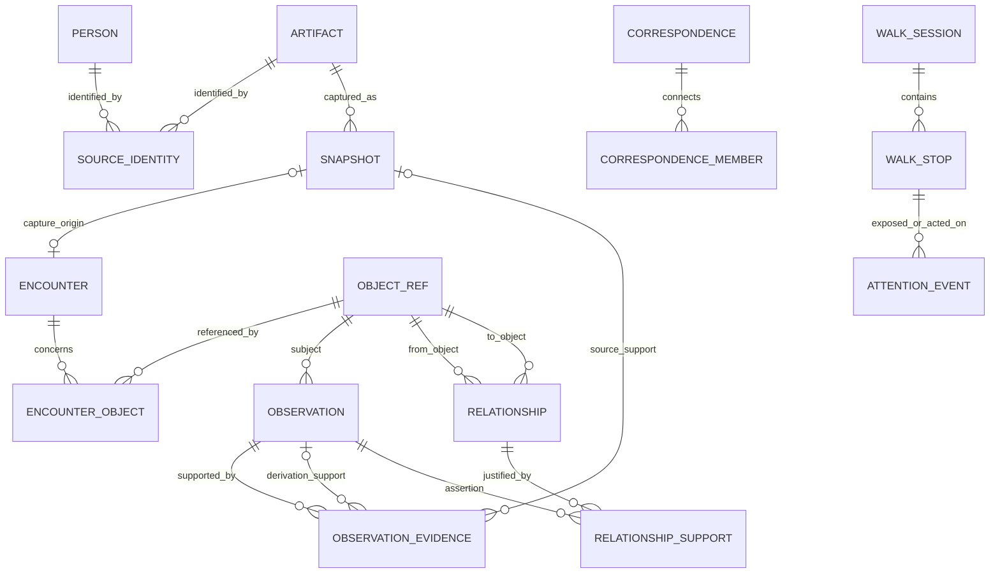

# Flaneur data model v2

Current update, 2026-10-19: Milestone C pattern-support qualification is READY for the scoped correction. Readable role witnesses now qualify domain candidates before independent-Person counting; irrelevant notes cannot corroborate roles. Reflect applies constraint/date qualification and current reviewed Concept proof checks. No schema or stored data changed. See [the exact live results, support, validation and deferred attribution debt](docs/phase3/PATTERN_SUPPORT_QUALIFICATION.md). This does not mark Phase 3 complete.

Current update, 2026-10-19: directed trajectories are implemented as immutable Person `relationship_assertion` Observations under `reviewed_trajectory` / `explicit-trajectory-v1`, with frozen from/to Concept meanings, exact User reasons, current support references, optional precision-preserving periods and revision/review lineage. Opt-in chronology candidates remain Inferred and excluded from transition Recall until explicitly confirmed into a User revision. A+B co-occurrence and static legacy graph edges never establish a transition. No new entity, table, graph predicate or migration was required; no permanent database change was applied. See [implemented contract and validation](docs/phase3/TRAJECTORY.md). Earlier proposal-only updates below are historical.

Current update, 2026-10-18: existing Person→Organisation `educated_at`/`employed_by` edges now have dedicated immutable User assertions, exact support/review validation and inspectable history. `fieldOfStudy` is a scoped structured education assertion value, exposed by a `field_of_study` retrieval filter; it is neither a new entity/predicate nor a general Concept association. Legacy education/role projections are not automatically promoted. No schema migration or permanent database change was needed. See [semantics, provenance and limits](docs/phase3/EDUCATION_EMPLOYMENT.md). The [hybrid trajectory design](docs/phase3/TRAJECTORY_PROPOSAL.md) is **proposed only**, not implemented.

Current update, 2026-10-18: associated_with_concept now supplies typed retrieval through current managed User decisions, without schema changes. Concept-target provenance carries the Relationship/Observation/Concept IDs and frozen label/category separately from Person-targeting author/profile provenance. Filter-only context cannot substitute for topical evidence; direct associations do not transfer through authorship. Exact Concept resolution clarifies ambiguous, missing or substituted identities. All 371 tests, clean TypeScript, build/package, 115 rollback-only SQL checks, 117 browser and 86 HTTP checks pass. No permanent data change, activation or deployment occurred. See [Concept retrieval contract](docs/phase3/REVIEWED_CONCEPT_RETRIEVAL.md).

Current update, 2026-10-18: associated_with_concept now supports explicit Person/Artifact owner interpretations using existing Relationship/Support/User Observation/Review tables. Deterministic edges retain frozen Concept label/category and exact confirmation/withdrawal reasons; active canonical endpoints and unchanged meaning determine current support. A dedicated relationshipReview guard protects generic actions, and retirement reaches ordinary retrieval dependencies. No source mention, Concept merge or legacy link is inferred. All 363 tests, TypeScript, build/package, 131 rollback-only SQL checks, 109 browser and 86 HTTP checks pass. No schema/permanent data change, activation or deployment occurred. See [association model and bounds](docs/phase3/REVIEWED_CONCEPT_ASSOCIATIONS.md).

Current update, 2026-10-18: existing managed authorship/profile relationships now supply typed Artifact retrieval filters without schema changes. Representative current User decisions retain relationship, Person, Observation, Snapshot and Encounter provenance as filter-only evidence, separate from topical content and external verification. Missing reviewed support excludes rather than produces an uncertain identity match. Exact canonical Person resolution clarifies missing/ambiguous/substituted identities. All 355 tests, TypeScript, build/package, 61 rollback-only SQL checks, 85 browser and 67 HTTP checks pass. No permanent data change, activation or deployment occurred. See [retrieval contract and bounds](docs/phase3/TYPED_RELATIONSHIP_RETRIEVAL.md).

Current update, 2026-10-18: read-only Person/Artifact authorship panels now project the existing managed authored_by edges and immutable User decisions. Current support is revalidated independently of stored edge state, with complete support/history counts, explicit limits and UUID paging. Rejected/inactive support remains historical; legacy author projections are not adopted. All 346 tests, TypeScript, build/package, 92 rollback-only SQL checks, 78 browser and 67 HTTP checks pass. No schema/permanent data change, activation or deployment occurred. See [panel model and bounds](docs/phase3/AUTHORSHIP_PANELS.md).

Current update, 2026-10-18: managed authored_by relationships now retain explicit per-capture User/partial relationship assertions and immutable withdrawal reviews using the existing schema. Each Artifact/Person pair can retain independent support from several captures; multiple authors are supported independently. Readers revalidate canonical objects, captures, support and reviews rather than trusting raw edge state. No Person fact, noticed link or source quotation is inferred. All 344 tests, TypeScript, build/package, 60 authorship SQL checks, 38 profile SQL regressions, 62 browser checks and 52 HTTP checks pass. SQL fixtures roll back with counts unchanged. No migration, permanent data change, activation or deployment occurred. See [authorship model and limits](docs/phase3/REVIEWED_POST_AUTHORSHIP.md).

Current update, 2026-10-18: existing Relationship/Support/Observation tables now support managed `profile_of` links derived from explicit per-capture User identity proofs. One edge per Artifact/Person pair retains independent immutable extracted/partial support assertions and dependency links to the User decisions. Current support is revalidated at read time; a stored active flag alone is insufficient. Source-identity conflicts stay candidates; legacy endpoints are not adopted and rejected edges are not reactivated. No authored-by or Person merge is inferred. All 336 tests, application TypeScript, build/package, 38 focused rollback-only SQL assertions, 45 browser and 37 HTTP checks pass. No schema/permanent data change, real decision, activation, backfill or deployment occurred. See [typed relationship model](docs/phase3/REVIEWED_PROFILE_RELATIONSHIPS.md).

The complete relationship regression set passes 185 rollback-only SQL assertions (38 focused, 63 identity, 44 reassignment, 40 creation). All fixture data rolls back with counts unchanged. No schema migration is required; the installed 0017 model remains the baseline.

Current update, 2026-10-18: reviewed profile reassignment uses existing Observation/Review/Encounter tables. A new User proof records the prior proof/Person, replacement and exact reason; the old proof receives an immutable rejected review. The current Encounter `noticed` projection is corrected, while old proof history, direct User notes, original source and normalized representations remain. No cross-Person supersedes pointer, source identity change, alias or authorship inference is created. Scoped dependency invalidation and parse enqueueing commit with the correction. All 331 tests, application TypeScript, build/package, 147 rollback-only SQL checks, 37 browser and 28 HTTP checks pass. No schema or permanent data change, real decision/job, activation or deployment occurred. See [reassignment model](docs/phase3/IDENTITY_REASSIGNMENT.md).

Database application, 2026-10-18: explicitly approved migration 0017 is installed on Neon dev. `person.profile_url` is nullable, its existing unique index remains, and the ledger contains 18 matching entries with 41 public tables and none pending. Source-neutral Person creation can now pass the prepared code's schema readiness check. The migration created no Person or attribution and did not enable capture-v2, run a real job or deploy code. Earlier entries below record preparation. See [application report](docs/database/PERSON_CREATION_MIGRATION_0017.md).

Installed-schema verification passes 40 creation, 63 identity and 14 export assertions. All fixtures roll back and counts stay unchanged; an idempotency migration rerun applies zero changes. Null URLs, preserved non-null URL uniqueness, explicit User identity proofs, request replay and export tag `0017` remain verified on the installed schema. Code/build/browser results below describe preparation and were not rerun for schema application.

Current update, 2026-10-18: proposed migration 0017 makes the legacy Person URL projection optional while preserving its non-null unique index. Prepared reviewed creation assigns a request-derived Person UUID, owner-entered name, null profile URL, immutable User identity proof and Encounter `noticed` link; source identity and authorship remain separate. Person/proof/link/parse writes are atomic and historical retries cannot recreate/reassign a Person. Export stays v3 with schema tag `0017` for the nullable catalog. All 324 tests, application TypeScript, build/package, 42 proposed-schema SQL checks, 63 identity and 14 export regressions, 26 browser and 25 HTTP checks pass. SQL rolled back; 0017 remains unapplied and creation stays disabled until approval/application. See [model and migration review](docs/database/PERSON_CREATION_MIGRATION_0017.md).

Current update, 2026-10-17: source-first review now connects an unresolved profile Snapshot to an explicitly selected existing Person through the existing User identity proof and Encounter `noticed` link. Confirmation/invalidation/parse head stay atomic; no Person source key, legacy Artifact author or typed relationship is inferred. Shared eligibility blocks new confirmation for inactive source/Encounter or missing v2 source links. Independent captures retain independent identity decisions. All 317 tests, application TypeScript, build/package, 63 rollback-only identity SQL checks, 16 browser and 17 HTTP checks pass. No schema, permanent data, activation, historical reconciliation or deployment changed. See [review semantics](docs/phase3/SOURCE_FIRST_IDENTITY_REVIEW.md).

Current update, 2026-10-17: the retrieval reader now derives per-capture source evidence directly from immutable Snapshot representations and explicit Artifact/Encounter source links. Evidence includes representation IDs and exact Unicode ranges, is gated by succeeded current-head processing and installed versions, and is excluded for inactive/unlinked sources. No Observation, source-fact assertion, Person attribution or new table is invented; display `body_text` remains separate. All 315 tests, both TypeScript checks, build/package, 60 rollback-only source SQL assertions and 15 query regressions pass. No schema, permanent data, activation, backfill or deployment changed. See [evidence projection and review limits](docs/phase3/SOURCE_BACKED_RECALL.md).

Current update, 2026-10-17: existing SourceIdentity/Artifact/Snapshot/Encounter tables now support v2 recorded-source resolution. Versioned hashed exact-profile-URL/post-ID keys are distinct from Person identity; snapshot-only keys preserve unidentified captures separately. Source links, original capture, User reason, jobs and receipt commit together. Inactive/conflicting mappings remain unresolved; no attribution or typed relationship is invented. New display text uses fenced, server-ordered projection while originals/representations remain immutable. All 308 tests, both TypeScript checks, build/package, 36 rollback-only source SQL checks, 37 pipeline regressions and 18 isolated HTTP checks pass. No schema, real data, activation, backfill or deployment changed. See [source model behavior](docs/phase2/SOURCE_ARTIFACT_RESOLUTION.md).

Current update, 2026-10-17: verified remote capture acknowledgements can now atomically replace local pending source entries with recoverable compact receipt markers, allowing the tested full-quota cleanup without losing saved status. Unacknowledged source entries remain intact; no server Encounter or attention event is inferred from local queuing. All 302 tests, both TypeScript checks, production build/package and 34 installed Chrome assertions pass. Browser restart uses fixture reload; ordinary installation/update remains unverified. No application data/schema, activation, backfill or deployment changed. See [installed storage verification](docs/phase2/INSTALLED_EXTENSION_VERIFICATION.md).

Current update, 2026-10-17: extension 0.2.0 persists pending v2 envelopes in trusted local storage and retains up to 200 compact acknowledgement receipts before cleaning up confirmed source entries. Local queuing is distinct from a committed server Encounter and does not manufacture attention events or processing completion. Stable UUIDs preserve transport retries; deliberate repeat saves get independent IDs. All 298 tests, both TypeScript checks, production build/package and 14 content-script browser checks pass. No database/schema, real capture/job, backfill or deployment changed; server capture remains disabled. See [local outbox semantics and limits](docs/phase2/EXTENSION_OUTBOX_INTEGRATION.md).

Current update, 2026-10-17: the existing snapshot/Encounter/User-reason/job/request model has a separately gated v2 endpoint and finite parse-worker command. Exact raw client timestamp spelling is retained in existing source-context JSON; UTC database times retain microseconds. Complete acknowledgements distinguish saved originals from processing outcomes; unresolved identity does not create a guessed Person link. All 285 tests, application/extension TypeScript, production build, 37 rollback-only SQL checks and 18 isolated HTTP checks pass. No schema or real notebook data changed; capture remains disabled and no real worker ran. See [runtime preparation](docs/phase2/CAPTURE_RUNTIME_PREPARATION.md).

Current update, 2026-10-17: Person/Concept pages consume read-only canonical Encounter trails and separately labelled legacy Artifact associations; they no longer treat old aggregate counts or person-to-post projections as verified facts. Concept observation history reuses truth-layer, review/dependency and evidence inspection. All 278 tests, TypeScript, production build, 31 rollback-only trail SQL checks, 15 Person regression checks and 16 signed-out HTTP checks pass. No schema or real notebook data changed; Neon remains at 17 applied entries and 41 public tables. See [trail presentation and remaining gaps](docs/phase3/PERSON_CONCEPT_TRAILS.md).

Current update, 2026-10-13: Artifact/Encounter and Snapshot records now have local read-only inspection pages. Exact text/context, source bytes, normalized representations, quotation integrity and archived history remain distinct from verified facts/identity. All 272 tests, TypeScript, build, 23 rollback-only SQL checks, 15 Person-reader regression checks and 19 HTTP checks pass. No schema, real notebook data, backfill or deployment changed. See [inspection integration](docs/phase3/MEMORY_INSPECTION.md).

Current update, 2026-10-13: actual Walk owner/graph lock contention and release passed 11 assertions across two Neon connections, with all synthetic sessions rolled back and counts unchanged. The real component passed 15 synthetic-API browser checks, including mobile/keyboard/visibility and idempotent retry behavior. All 266 tests and TypeScript pass. No schema/real notebook/deployment changed. Deployed authenticated behavior remains unverified. See [Walk verification](docs/phase3/WALK_VERIFICATION.md).

Current update, 2026-10-13: persistent Walk storage is connected to local owner-protected routes/UI. Current evidence is resolved separately from frozen selection metadata; exposure is recorded separately from selection, and explicit resume resolves unavailable stops without refill. All 266 tests, TypeScript, production build, 70 rollback-only SQL checks and ten HTTP checks pass. No schema, real action, backfill or deployment changed; the ledger remains 17 applied entries/41 public tables. See [live Walk integration](docs/phase3/LIVE_WALK.md).

Current update, 2026-10-13: approved migration 0016 is installed on Neon dev. The notebook has 41 public tables and the ledger has 17 matching applied entries with none pending. Walk/session/event and v3 export validation passed 59 and 14 rollback-only checks respectively; counts were unchanged and idempotency applied zero migrations. No backfill, real action or deployment occurred. The prior 258-test/TypeScript/build baseline stands; live Walk integration remains pending. See [migration application](docs/database/WALK_MIGRATION_0016.md).

Current update, 2026-10-13: Walk migration 0016 and matching Drizzle definitions/snapshot/journal are prepared. The complete 41-table schema exports v3 with exact textual cells; the existing 38-table schema retains v2. All 258 synthetic tests, TypeScript, production build, schema regeneration, 59 rollback-only migration/export checks and 14 current-schema export checks pass. Neon remains at 16 matching applied entries and 38 public tables; 0016 needs new authorization. See [migration review](docs/database/WALK_MIGRATION_0016.md).

Current update, 2026-10-13: `walk_session`, `walk_stop` and `attention_event` are proposed with supplied-connection services, immutable ordered membership, terminal completion, idempotent explicit events and separate exposure recording. Stops retain historical reason/support references and rank inputs without copying source text. All 255 synthetic tests, TypeScript, production build and 47 rollback-only SQL checks pass. The proposal is outside the migration ledger and absent from Neon after rollback. Drizzle/export preparation and explicit permanent migration authorization remain required before live integration. See [Walk storage preparation](docs/phase3/WALK_SESSIONS.md).

Current update, 2026-10-13: contextual Walk candidates now have a prepared read-only adapter using current observation evidence and active canonical People/Artifacts. The live legacy draft action no longer changes contact status. No Walk tables were added; persistent sessions/stops/attention events remain the next prepared schema/service slice before cutover. All 251 synthetic tests, TypeScript, production build, 15 rollback-only Walk SQL checks and eight HTTP checks pass. See [Walk preparation](docs/phase3/CONTEXTUAL_WALK.md).

Current update, 2026-10-13: live local queries now read current v2 observations with immutable revision/archive eligibility and distinct unmapped legacy-note provenance. No historical note is silently converted or promoted to a typed fact. Snapshot notes associated with archived/aliased recorded Encounters are excluded. All 243 synthetic tests, TypeScript, production build, 15 rollback-only query SQL checks and nine HTTP rejection checks pass. No schema, real notebook data, backfill or deployment changed. See [live query integration](docs/phase3/LIVE_MEMORY_QUERY.md); earlier entries retain history.

Current update, 2026-10-12: new Person notes append immutable User observations; revisions preserve original text through the correction service. Exact text and retry IDs are retained. Legacy in-place PATCH is retired, and earlier notes remain preserved/read-only until reviewed backfill. All 233 synthetic tests, TypeScript, production build and 17 rollback-only authoring SQL checks pass; built-note rejection smoke passed five HTTP assertions. No real note, schema migration, bulk backfill or deployment occurred. V2 recall/resurfacing cutover and browser verification remain pending. See [immutable authoring](docs/phase3/IMMUTABLE_NOTES.md). Earlier entries retain history.

Current update, 2026-10-12: Person archive controls now preserve inspectable history and suppress archived/aliased Persons from active legacy readers. Notes and Walk writes enforce registry locks. ORM/direct SQL pools are separated to protect timestamp/JSON codecs; restart application processes. All 228 synthetic tests, TypeScript, production build and 119 rollback-only compatibility SQL checks pass. The final built app passed 12 HTTP smoke assertions. No real Person archival, migration, backfill or deployment occurred; browser verification and remaining reader/capture migration stay pending. See [archival integration](docs/phase3/PERSON_ARCHIVE_UI.md). Earlier entries retain their history.

Current update, 2026-10-12: the Person page now has dedicated captured-profile identity inspection and explicit confirm/reject controls. Conflicting associations are not automatically resolved, and unsupported/archived captures cannot be confirmed. All 226 synthetic tests, TypeScript, production build, 20 rollback-only identity inspection/decision SQL checks, and 10 built-identity HTTP checks pass. No real identity decision, schema migration, backfill or deployment occurred; interactive browser verification and broader Person/capture migration remain pending. See [identity integration](docs/phase3/IDENTITY_INSPECTION.md). Earlier entries retain their history.

Current update, 2026-10-12: the Person page now has stored observation/evidence inspection and explicit confirm/correct/reject/archive controls under owner sessions. Historical text/truth layers and decision history are retained; identity proofs require separate review. Person metadata is now protected before name lookup. All 221 synthetic tests, TypeScript, production build, 15 rollback-only inspection SQL checks, and 11 built-inspection HTTP checks pass. No new migration, backfill, real review or deployment occurred; interactive browser verification and further Person-page migration remain pending. See [inspection integration](docs/phase3/OBSERVATION_INSPECTION.md). Older entries retain preparation history.

Current update, 2026-10-12: the local review route connects all seven prepared review/archive services to owner-session write authorization and exact HTTPS Origin checks. All 217 synthetic tests, TypeScript, production build, 131 rollback-only Neon review SQL checks, and 10 built-route HTTP rejection checks pass. No real review, new migration, backfill, or deployment was performed; inspection/review UI and HTTPS browser verification remain pending. See [review integration](docs/phase3/REVIEW_ROUTE.md). Earlier entries retain their history.

Current update, 2026-10-12: the local export route now serves the reviewed v2 notebook format under owner-session authorization. The partial legacy exporter was removed; Settings reports download failures. Buffered delivery enforces a 4 MiB cap with explicit failure rather than partial output. All 214 synthetic tests, TypeScript, production build, 14 rollback-only export SQL checks, and 13 built-route HTTP rejection checks pass. No migration, private export file, or Vercel deployment was created; restoration remains deferred. See [export integration](docs/export/MEMORY_EXPORT_V2.md). Earlier entries retain their history.

Current update, 2026-10-12: owner-password configuration passes the private readiness check. Dashboard login/logout, page authentication, and async API guards now use revocable owner sessions in the local codebase; extension capture keeps its separate credential. All 212 synthetic tests, TypeScript, the production build, and 22 built-app HTTP smoke assertions pass. No Vercel deployment or database mutation was performed; HTTPS browser login/cookie verification remains pending. The ledger remains 16 applied entries. See [dashboard integration](docs/phase3/DASHBOARD_AUTH.md). Earlier statements below retain preparation history.

Current update, 2026-10-12: owner-session server composition and private auth:status checks are prepared. All 207 synthetic tests and TypeScript pass. The selected HTTPS origin is saved locally and passes the private readiness check; owner-password configuration remains unready and the runtime database URL is configured. Live login remains disconnected, no database or Vercel deployment was changed, and the ledger remains 16 applied entries. See [server integration contract](docs/phase3/OWNER_RUNTIME.md). Older entries below retain historical counts/state.

Current update, 2026-10-12: migration 0015_shared_login_throttle was explicitly authorized and committed on Neon dev through DIRECT_URL. The ledger has 16 matching applied entries and no pending migrations; actual-schema throttle validation passed 21 rollback-only checks with state/counts unchanged, and an idempotency rerun applied zero migrations. The preparation baseline remains 200 synthetic tests and TypeScript passing. Password enrollment is unconfirmed and live login remains disconnected. See [throttle contract](docs/phase3/LOGIN_THROTTLE.md). Earlier updates below retain their historical counts and migration state.

Update, 2026-10-12: migration 0014 was explicitly authorized and committed on Neon dev through DIRECT_URL. The ledger now has 15 matching entries and no pending migrations. Actual-schema session validation passed 19 checks with fixtures rolled back and state unchanged; an idempotency rerun applied zero migrations. The preceding 211-check complete SQL baseline and 39-check pre-application session run remain separate. The synthetic baseline is 196 passing tests with TypeScript/schema-drift checks passing. Live login/routes, password enrollment, throttling, backfill, and restoration verification remain pending. See [session migration report](docs/database/SESSION_MIGRATION_0014.md).

Physical decisions in the prepared slice: Artifact uses the existing type enum expanded with source-neutral kinds; legacy post/connection_request values remain inspectable. Author columns become optional compatibility projections with restrictive deletion; multiple authors use relationships. Relationships have a unique endpoint/predicate identity and candidate/active/rejected state, with independent support assertions. Capture requests and processing job/run/head storage are available on Neon dev but remain disconnected from live routes; request-to-snapshot uniqueness provides the reverse capture-request lookup without a redundant circular snapshot FK. Place, Correspondence, complete search/evidence normalization, and attention/session storage remain staged additions. See [Phase 2 status](docs/phase2/STATUS.md).

This is a proposed design contract, not executable SQL or a claim about the live database. Implementation order and release gates are in [MIGRATION_PLAN.md](MIGRATION_PLAN.md). Postgres, Drizzle, and pgvector are candidate infrastructure to reuse where they support the target. Preserve reference continuity for existing user/source data; exact physical migrations, triggers, enum strategy, and worker hosting are future implementation decisions.

The new PRD is authoritative for product behavior. The existing app and schema embody an earlier hypothesis and carry no presumption of correctness. Table shapes, projections, classifiers, embeddings, identity resolution, and algorithms may be replaced or removed. The concrete model below is an engineering proposal to evaluate against the new PRD, not a requirement to preserve the existing implementation.

## 1. Domain principles

- Person and Artifact describe what exists in the user's trail. Encounter records a distinct occasion of attention. Snapshot preserves captured material. These identities are separate.
- Observation records a statement and whether it is User, Source, Extracted, or Inferred. Evidence records its support; confidence does not replace provenance.
- Deduplicate objects and transport retries, never distinct intentional encounters.
- User text and original snapshots are authoritative retained data. Search documents, summaries, and aggregate edges are rebuildable derivations.
- Missing history stays unknown. A new inference about an old capture is not the user's historical motivation.
- Core objects are source-neutral. LinkedIn identifiers and parser details belong to source identities and adapters.
- No multi-tenant redesign, manual ontology, event-sourcing framework, or universal capture requirement is introduced for the single-user MVP.
- Preserve original user/source evidence and resolvable historical references, not obsolete behavior or unsupported derived claims. Validate existing merges/classifications; correct them with attributable mappings and evidence rather than treating current rows as truth.

## 2. Relationships

Each main object below has exactly one `object_ref` row with the same UUID. Source capture may remain unresolved, so Snapshot's Artifact and Encounter's object links can initially be absent. Relationship endpoints and evidence chains are actual foreign-key references, not unchecked `type + id` JSON.

## 3. Shared identity and references

| Table | Key fields | Constraints / purpose |
| --- | --- | --- |
| `object_ref` | `id UUID PK`, `kind`, `created_at`, `archived_at?` | Kinds: person, artifact, encounter, observation, concept, organisation, place, correspondence |
| `source_identity` | `id`, `object_id FK`, `adapter_id`, `identity_kind`, `external_key`, `canonical_url?`, `resolution_layer`, `confidence?`, `assertion_id?` | Unique `(adapter_id, identity_kind, external_key)`; auto-assignment only with sufficient identity evidence |
| `object_alias` | `former_object_id FK`, `canonical_object_id FK`, `merged_at`, `decision_observation_id FK` | No self-link/cycle; preserves old URLs/references after explicit merges |

Subtype tables use existing UUIDs where the object identity remains valid; explicit migration mappings/aliases preserve references when an object must be split, merged, or reclassified. The reference kind must match the subtype, and every committed reference must have exactly one matching subtype. Enforce the contract transactionally with database-level subtype checks during implementation; a foreign key alone is insufficient. Preflight UUID collisions and historical identity correctness before registering rows.

This registry is proposed to give real referential integrity to shared links. It is not a replacement for typed domain tables. An equivalent constrained typed-junction design may be chosen before Phase 1 if it preserves all contracts; do not ship unconstrained polymorphic IDs.

Normalize source URLs with adapter-specific rules. Do not assume all URL variants are identical or discard meaningful query parameters globally. Same name, headline, or embedding similarity is not sufficient proof of person identity. Ambiguous resolution is a candidate inference; leave captures unresolved or linked to separate people until confirmed.

## 4. Person, Artifact, Organisation, and Place

| Object | Proposed fields | Notes |
| --- | --- | --- |
| `person` | Existing `id`, `name`, headline/about/location/photo projections; `first_captured_at`; `last_profile_sync_at?` | Preserve existing UUID; profile URL becomes an optional preferred-source projection rather than core identity |
| `artifact` | Existing `id`; `kind`; title/text projections; `canonical_source_url?`; `published_at?`, `published_precision`; media references; `first_captured_at`, `last_captured_at` | Kinds initially profile_page, social_post, article, project, portfolio_page, personal_website |
| `organisation` | Existing `id`, display name; `kind?`; existing slug as legacy alias | Company, school, lab, other; globally unique slug must not remain the cross-source identity rule |
| `place` | `id`, display name, optional normalized locality/region/country, source identities | Create only with sufficiently supported resolution; retain source location strings |

Source facts and generated interpretations do not become indistinguishable by being copied into projection fields. Projections must resolve to the selected Observation(s) supporting them. Preserve richer history in Observations and Snapshots; a projection is the current display/search value.

Authorship and profile-subject associations use typed Relationships (`authored_by`, `profile_of`). Existing `artifact.person_id` / `organisation_id` remain compatibility projections during transition. Existing one-author data survives; v2 permits unknown attribution during processing and multiple supported authors without inventing a person for every page.

Legacy `connection_request` artifacts remain inspectable with their IDs and original type; they do not silently become authored work. New capture writes use source Artifact kinds, while contact state lives on Person. Retire legacy types only after an explicit mapping of actual rows.

Published time, captured time, observed change time, and system processing time are distinct. Preserve day/month/year/absent precision as applicable. Unknown publication dates remain null. Media may be an immutable captured blob or an external URL; label which is retained so portability is honest.

## 5. Snapshot and capture durability

Extend existing `snapshot` without changing its ID or compressed payload:

| Field | Meaning |
| --- | --- |
| `id`, `content_gzip`, `source_url`, `captured_at` | Original captured source and timestamp |
| `artifact_id?`, legacy `person_id?` | Resolved source object; nullable for unparsed/quarantined capture |
| `capture_request_id? UNIQUE` | One new intentional Save request; historical snapshots have a stable migration mapping instead |
| `adapter_id?`, `capture_kind`, `extension_version?` | Source-neutral capture metadata; legacy profile/post values preserved |
| `content_hash`, `content_type`, `normalization_version?`, `normalized_text?` | Integrity and immutable excerpt coordinate basis |
| `sections_covered`, `coverage_json?` | What was present, complete, truncated, or unavailable |
| `parser_version` | Preserve legacy value; detailed parse/enrichment executions live in `processing_run` |

Treat raw payload and normalized evidence text as immutable. A parser/normalizer change creates a versioned derived representation/run, not rewritten evidence offsets. URLs need not stay live for captured evidence to remain inspectable. Inspection must render sanitized text/media, never execute captured HTML.

`capture_request` stores `id UUID PK`, adapter/source URL, payload hash, `snapshot_id UNIQUE FK`, `encounter_id UNIQUE FK`, and server receipt time. A retry reuses its client-generated UUID and must have the same payload hash; mismatched reuse is rejected. One transaction stores request, Snapshot, capture Encounter, and optional user reason before durable acknowledgment.

A new Save gesture uses a new request UUID even for identical content. The extension outbox holds the same UUID/payload across network retries and reloads. An identical payload hash alone must never suppress a legitimate second encounter. Server authentication and size validation precede storage; model work follows acknowledgment.

## 6. Encounter: the history of attention

| Table | Fields / constraints |
| --- | --- |
| `encounter` | `id FK object_ref`, `kind`, `occurred_at`, `recorded_at`, `source_context?`, `snapshot_id? UNIQUE FK`, `explicit_context_text?`, `migration_key? UNIQUE` |
| `encounter_object` | `(encounter_id FK, object_id FK, relation) PK`; relation: noticed, source, author, related; linked IDs may resolve after parsing |

Encounter kinds initially: captured, intentionally_opened, resurfaced, contacted. Capture creates an Encounter even when entity resolution fails. Do not equate every returned search result, hover, or background update with an intentional encounter. Record actual Walk exposure separately and create a resurfaced Encounter only under a defined visibility contract.

`reason_for_noticing` is a first-class semantic role of an Observation whose subject is the Encounter. The selected user reason and inferred fallback are resolved by indexed subject/role queries; optional cached IDs must point to the same Encounter and remain rebuildable. Absence is allowed; an invented reason is not required for every save.

User reason outranks inferred fallback. Later refinements retain revisions and timestamps. Explicit current context belongs to the Encounter/query request; a persistent project entity is deferred. Keep captured/source context separate from inferred context.

The Person timeline follows Encounter-object links, not Artifact creation dates. Two saves of one post yield one Artifact, two Snapshots, and two capture Encounters, with distinct user reasons where supplied.

## 7. Observation and evidence

The prepared explicit identity-confirmation service appends a User fact with snapshot/request IDs and optional same-subject `supersedes_id`, then atomically updates the noticed link and parse input head. It selects an existing canonical Person and rejects reassignment; no person merges or creations occur. Parse fingerprints include the current identity-proof ID, and capture-field IDs/provenance include that input fingerprint. Readers hide obsolete derivations while retaining their history and User text. A prepared rejection service appends a review of the unique active proof and atomically changes the desired parse head to unresolved input. Retry receipts return historical decisions without invalidating later proofs. Stale/ambiguous reviews fail; reassignment and removal of historical encounter links are separate reviewed decisions. Authenticated callers, broader resolution/review, and real database validation remain pending.

Prepared field extraction now appends Extracted fact observations with `capture_field:<field>`, a structured retrieval field/value, extractor version, snapshot ID, identity-proof observation ID, and parse input fingerprint. It appends snapshot support and exact text locators in the current processing lease's transaction. Stable IDs permit conflict-checked retries; changed output is never silently overwritten. Existing education/role projections are not replaced by this slice. Current-input filtering is prepared; broader resolution/review, downstream invalidation, and SQL validation remain pending. No database writer is activated.

The prepared reader now retains original observation/snapshot locator identifiers in provenance and creates stable per-object citation IDs when an encounter observation projects to several linked objects. Exact source verification requires a same-snapshot supporting excerpt; legacy support flags alone do not grant verification. Candidate counts are scoped by object kind and available observation text, not embedding presence. Versioned captured-DOM normalization and read-only PostgreSQL adapter code remain disconnected and untested against the database; structured coverage and temporal verification remain partial.

Prepared Phase 3 physical additions (unapplied migration 0012): `snapshot_representation` stores snapshot FK, normalizer version, exact plaintext, UTF-8 SHA-256 hash, and creation time; snapshot/version is unique and updates are prohibited. `text_evidence` references one observation-evidence record and one representation, with zero-based start/end Unicode code-point offsets and an exact quote. SQL guards require the same snapshot, matching excerpt, and exact substring. These guards remain untested against PostgreSQL. Representation creation takes adapter-supplied plaintext; it does not itself normalize HTML or grant verified support. See [Phase 3 status](docs/phase3/STATUS.md).

Unapplied migration 0013 prepares `observation_derivation`: one immutable row per extracted capture-field observation, with foreign keys to the original snapshot, identity-proof observation, parse job, and normalized representation, plus the exact input fingerprint. SQL guards check matching subjects, snapshot/input/representation identity, metadata consistency, and exact supporting text evidence. Job input identity and review updates are immutable; lease/state transitions remain permitted. These guards are authored but untested against PostgreSQL. Current-head eligibility is separate from historical dependency integrity. The reader uses relational references rather than JSON provenance, hides capture fields with missing references, and grants source verification only through the bound representation. This slice covers captured profile fields; enrich/index dependency storage and invalidation remain pending. Coordinated deletion/export policies must include these references; no blanket cascade is added.

| Field | Proposed contract |
| --- | --- |
| `id FK object_ref`, `subject_id FK object_ref` | Stable statement identity and subject |
| `truth_layer` | user, source, extracted, inferred |
| `semantic_role` | reason_for_noticing, note, fact, summary, classification, relationship_assertion, selection_reason |
| `body_text`, `structured_value?`, `field_key?` | Readable statement and optional typed value; field keys refer to stable row IDs, not array positions |
| `observed_at?`, `recorded_at` | Time evidenced by source/user versus time stored; unknown historical observation time stays null |
| `processing_run_id? FK`, `confidence?` | Derivation and optional confidence in [0,1] |
| `support_status` | verified, partial, legacy_unverified, unsupported; independent of truth layer |
| `supersedes_id? FK`, `origin_key? UNIQUE` | Append-only revision linkage; idempotent derivation/backfill identity |

Truth layers: User is written/explicitly confirmed by the user; Source is explicitly stated in captured material; Extracted is structured from source evidence; Inferred is interpretation. Model-written summaries, role domains/modes, and proposed motivations are Inferred unless a particular statement can be grounded as Source/Extracted.

`observation_evidence`: `id`, `observation_id FK`, exactly one of `snapshot_id FK` or `supporting_observation_id FK`, `excerpt?`, `locator_json?`, `support_role` (supports/contradicts), and `evidence_version`. Snapshot locators refer to immutable text offsets/section or retained media coordinates. Reject invalid/out-of-range excerpts and self/cyclic observation support.

A direct source statement requires captured support. Extracted fields require support back to a source. Inferred statements may cite source/extracted/user observations, but their layer remains Inferred. User statements may stand without external evidence. Legacy derivations with unavailable support remain inspectable but cannot be presented as verified source facts.

`observation_review`: `id`, `observation_id FK`, decision (confirmed/rejected/corrected), `reviewed_at`, `replacement_observation_id? FK`, optional user comment. Confirmation creates a linked User observation rather than relabeling the original Inferred statement. Correction appends a new observation; rejection excludes the assertion from active inference/search/relationships without deleting original evidence.

Prepared generic confirmation copies the exact stored body of an active Source/Extracted/Inferred assertion into a new same-subject User revision and records a confirmed review. The original truth layer and evidence remain unchanged; confirmation metadata references the original and review without copying field projections or model values. Replacement/review creation and dependent work invalidation are atomic. Idempotent retries return historical receipts without resetting later heads; clients cannot submit replacement text through this path. User assertions require revision and identity proofs require dedicated review. Authenticated callers and typed-field confirmation remain pending.

The prepared review HTTP factory dispatches explicit observation/identity/archive requests to their transactional services with an injected authorization policy, exact configured-origin check, bounded strict JSON, and private stable errors. It accepts per-gesture UUIDs and preserves service replay semantics. Revocable sessions/permission policy, review UI, and live route integration remain pending; no model output automatically invokes this factory. See [HTTP contract](docs/phase3/REVIEW_HTTP.md). No schema changes are introduced by this boundary.

Prepared identity confirmation/rejection also invalidates enrichment/index scopes for recorded non-User descendants of the snapshot's historical identity proofs. Shared dependency planning locks all affected object scopes and the parse scope before the memory graph, then recomputes the closure with bounded retries. Proof/review creation, supported relationship withdrawal, object job/run supersession, and parse-input changes commit together. Historical replays do not reset newer work. Proofs, evidence, User notes, and historical encounter links remain retained; no identity reassignment is performed. Missing provenance and archive mutation wiring for other object kinds and alias changes remain separate gaps.

Prepared explicit text correction creates a new User observation with the original subject and semantic role, exact authored body, same-subject supersedes link, review-reference metadata, and current recorded time. It does not inherit source/extracted field keys, values, quotations, or identity associations. Original observations/evidence remain unchanged. Replacement/review creation and dependency/job invalidation share one transaction; retries compare exact payloads and never reset later revisions/heads. User text can be explicitly revised through this path; identity proofs require their dedicated review flow. Plain text corrections do not populate structured field constraints automatically. Authentication and explicit typed-field correction remain pending.

Prepared generic rejection now appends a review of an active Source/Extracted/Inferred observation and atomically invalidates existing enrichment/index work for its subject and recorded non-User descendant subjects. Supporting-observation links and typed identity dependencies define the closure; contradiction links and User-authored descendants do not propagate automatic withdrawal. Active relationships with affected support return to candidate state pending reevaluation. Review-specific processing-head fingerprints fence old work without inventing replacement inputs. Replays cannot reset later heads. Original records and User text remain retained; User text uses authored revision and identity proofs use their dedicated review flow. Missing historical dependency links, archive/alias job invalidation for other object kinds, and future producer input checks remain pending. This code uses the already applied dev schema and remains disconnected from live routes.

Editing user text appends a revision. Historical note bodies have no edit timestamps; import the currently known body with original note identity and explicit legacy revision uncertainty. Do not imply it was the text at capture time. Foreign keys and append-only rules do not prevent deliberate deletion under user data controls.

Prepared explicit observation archival changes only `object_ref.archived_at` and dependent operational state, retaining the original observation and evidence. It accepts an active assertion, including explicitly selected User text, but routes identity proofs to dedicated review. Archive/invalidation/receipt persistence share one transaction; replay returns the original archive timestamp without resetting newer processing heads. The physical `migration_receipt` table also stores these operation receipts under a distinct `observation-archive:` key namespace with a target/operation fingerprint. Export and later deletion policies must account for operation receipts. Archival of other object kinds, unarchive, authenticated controls, and alias mutations remain pending; this is not a deletion implementation.

Prepared Person archival marks only an active canonical Person's reference archived. Their observations become ineligible through the archived subject while remaining physically retained, including User text and identity proofs. Recorded non-User dependents on other subjects become ineligible; independent User notes and encounter history remain retained and eligible. The transaction locks dynamic parse scopes from historical identity/derivation provenance along with affected object scopes, invalidates processing heads/jobs/runs, and withdraws active relationships involving the Person or affected support. No replacement parse job is guessed. A `person-archive:` operation receipt preserves retry identity and original timestamp. Mutation/invalidation/receipt persistence are atomic. Authentication/UI, other object kinds, unarchive, alias mutations, and full deletion/export remain pending.

## 8. Trajectory and structured projections

Existing `role`, `education`, `skill`, `headline_history`, and `section_coverage` records are migration inputs. Reuse their structures only where they support the new PRD; validate deduplication, date precision, and source associations before active use. Preserve original evidence and reference mappings when correcting or restructuring rows. The proposed normalized projection adds `education.organisation_id?` for sufficiently resolved schools and retains original school string/slug. Location-to-Place resolution is an evidenced relationship, not destructive text normalization.

Use `role_observation(role_id FK, observation_id FK, field_key)` and equivalent `education_observation` / `skill_observation` joins for field-level support. A Person-level Observation can name the stable structured row in its field key; these typed joins enforce that the row exists. Domain/mode/is_primary inference must not be bundled into neutral source role facts.

Role/education identity cannot depend only on exact start date. A year-to-month improvement refines an existing supported row when title/organization/source context agree; ambiguous candidates remain separate pending resolution. Changed facts invalidate only dependent derivations, preserving old claims and their evidence.

Trajectory interpretations derive from ordered supported roles/education with explicit uncertainty. Unknown dates and overlapping roles must not produce a confident transition. Section coverage denotes capture completeness; absence of a row is not proof a person lacks a role/school/skill.

## 9. Concepts, typed relationships, and correspondences

| Table | Contract |
| --- | --- |
| `concept` | Retain existing ID/label/kind; aliases and current label remain attributable; frequency is derived |
| `relationship` | `id`, `from_object_id FK`, `to_object_id FK`, `predicate`, `origin_key UNIQUE`, `valid_from?`, `valid_to?` |
| `relationship_support` | `(relationship_id FK, observation_id FK) PK`; provenance remains on assertions, not a single merged edge flag |
| `correspondence` | `id FK object_ref`, `observation_id FK`, `kind`, `created_at`, optional algorithm/run version |
| `correspondence_member` | `(correspondence_id FK, object_id FK, role) PK`; at least two distinct connected objects |

Initial predicates: authored_by, profile_of, mentions_concept, associated_with_concept, employed_by, educated_at, located_in, similar_trajectory, relevant_to. Enforce an endpoint-kind matrix and required supported assertions before activation. Example: educated_at connects Person to Organisation, authored_by connects Artifact to Person/Organisation. No generic user-maintained ontology is needed.

Preserve source hashtags/headings as Source observations and inferred labels as separate Inferred observations even if both resolve to one Concept. Keep exact original terms in supporting observations. Multiple assertions can justify one logical relationship without overwriting their origins. Concept merges are conservative and retain aliases; threshold tuning is an evaluation task.

`concept_link` and `concept_edge` may serve as temporary compatibility/aggregate views; remove or replace them if the v2 relationship model makes them redundant. Co-occurrence counts come from distinct active Artifact–Concept relationships, not number of assertions or captures. Store canonical concept pairs and recompute counts from authoritative links; do not replay additive deltas onto retained aggregates. Existing frequency-based topic promotion and similarity thresholds have no presumed validity: retain them only if evaluation shows they improve target recall/relationships without suppressing useful concepts or losing provenance.

A Correspondence is an evidence-backed observation connecting independently encountered objects; shared tags alone do not establish meaningful similarity. Store supporting observations, confidence/uncertainty, and review decisions. Basic correspondence is staged after the MVP foundation. It can render without Atlas, and rejected/unsupported support invalidates its active presentation.

## 10. Resurfacing and contact

| Table | Fields / rules |
| --- | --- |
| `walk_session` | `id`, local date, timezone, created/completed times, optional explicit context; unique user-local-day boundary for initial single-user policy |
| `walk_stop` | `id`, `session_id FK`, position 1–3, `object_id FK`, immutable historical selection reasons/support references, rank version/input summary, terminal resolution/time; unique position and object per session |
| `attention_event` | `id`, `object_id FK`, `encounter_id? FK`, `walk_stop_id? FK`, kind, `occurred_at?`, `recorded_at`, `origin_key UNIQUE`, optional legacy metadata |
| `resurfacing_preference` | `object_id PK FK`, optional suppression-until / explicit archive choice; aggregates derived from events |
| `person_contact_state` | `person_id PK FK`, state (not_contacted/contacted/replied/quiet/unknown), `assertion_id FK`, `updated_at` |

Attention events include shown, opened, useful, kept, reduced, dismissed, and explicit contact confirmation. Record actual exposure, not selection alone; persist session completion so navigation cannot refill it. Local-day timezone is explicit; changing timezone cannot silently create unlimited sessions. Empty/short sessions are valid.

Selection uses age, salience, repeated encounters, supplied context, supported change/correspondence, diversity, and negative feedback. Store a supported appearance reason, not raw algorithm jargon in the UI. Weights remain undecided. There is no requirement to schedule every object; dismissal reduces exposure rather than resetting a one-day interval.

Contact state is secondary and based on user-confirmed assertions. Copying a draft/opening LinkedIn does not confirm contact. Preserve legacy pending/accepted/messaged/replied/gone_quiet assertions separately; do not invent contact dates or silently treat a legacy automatic messaged update as proof.

Legacy schedule is retained read-only during transition. Its last action may become a tagged legacy event with known time or null; do not manufacture earlier events, current-context reasons, or continuous history.

## 11. Processing and retrieval derivations

| Table | Fields / role |
| --- | --- |
| `processing_job` | `id`, target reference/snapshot, kind, input fingerprint, state, attempts, available/leased times, lease token, bounded last error; unique target/kind/fingerprint |
| `processing_run` | `id`, job/target, input fingerprint, adapter/parser/prompt/model versions, started/finished times, outcome |
| `search_document` | `id`, `object_id FK`, `observation_id? FK`, `snapshot_id? FK`, text/chunk, truth layer, input fingerprint, embedding/model/dimensions, updated time |
| `search_document_evidence` | `(search_document_id FK, evidence_id FK) PK`; exact support for retrieved fragments |

Jobs are durable, retryable, leased, and idempotent. Invalidated inputs create new derivations; obsolete job results cannot overwrite newer projections. Preserve quarantine/parser health, but show processing status separately from capture success. Worker hosting and retry caps require deployment inspection.

Search documents are versioned derived representations of source fragments, user reasons/notes, extracted facts, and explicitly typed inference. Existing 768-dimensional embeddings are reusable only when their inputs, provenance, task type, and retrieval quality meet the new contract; regenerate or replace them otherwise. Never mix incompatible model/dimension/task spaces. Exact scans remain acceptable at small scale; index changes follow measured retrieval needs.

Query contract: intent (Recall/Resurface/Reflect), explicit context, structured constraints, candidate objects, bounded evidence IDs, coverage, uncertainty, and abstention. Semantic and structured branches use one coherent evidence population. Time means encounter/observation time where requested, not automatically employment dates.

Rank with relevance first, then explicit user salience/repeated attention/time/context/diversity as appropriate. Generated summaries aid retrieval but are not source proof. No three-person minimum for Recall. Reflection requires population coverage, not just the twelve nearest documents.

Answers carry claim text, truth/interpretation labels, and validated evidence IDs. A citation may point to a snapshot-backed Source/Extracted observation or a clearly labeled User/Inferred one. Unknown citation IDs are rejected; never substitute every retrieved document as support. Persist query history only if deliberately needed/disclosed; ephemeral responses are sufficient for MVP.

Saved queries retain existing IDs/text and a versioned planner representation. Replan incompatible routing explicitly while retaining old routing for inspection. ID arrays must resolve through aliases after merges; migration preserves IDs so backfill does not itself change matches.

## 12. Backfill mapping

| Existing table/data | V2 mapping | Historical limit |
| --- | --- | --- |
| Person/Artifact/Concept/Organisation | Validate identity; reuse IDs or preserve explicit correction mappings; add identities | Existing merges are not automatically correct |
| Profile snapshot | Reuse/create profile Artifact; retain Snapshot ID; capture Encounter keyed by snapshot | Capture coverage remains partial |
| Post snapshot | Link existing deduplicated Artifact; separate capture Encounter | Same Artifact can have many Encounters |
| Quarantined/unlinked snapshot | Retained Snapshot and unresolved capture Encounter | No invented author/object |
| Snapshot-linked Note | Preserve Note ID as User Observation; link Encounter | Original pre-edit wording/time unknown |
| Snapshotless Note | Person/Artifact User Observation | No invented encounter association |
| Role/education/skill | Validate/restructure projections; preserve source evidence/reference mappings; supported observations where recoverable | Missing field evidence is explicitly legacy_unverified |
| Headline history | Preserve observed values/times; source observations only with recoverable evidence | Timestamp alone is not an excerpt |
| Synthesis/domain/mode/is_primary | Inferred observations with known versions | Historical input set may be unknown |
| Hashtag/concept link | Source/inferred assertion support, then logical relationship | Some original inferred labels cannot be reconstructed |
| Schedule/status | Legacy state/assertions; only last known action | No complete exposure/contact timeline |

Use deterministic unique migration keys such as `snapshot:<id>:capture`, `note:<id>:current`, and `role:<id>:<field>:legacy`. Preserve Snapshot/Note identities for originals; allocate new Encounter/profile Artifact IDs once and persist mappings. Record entity corrections explicitly. Never regenerate IDs on each run or preserve an erroneous projection solely for ID stability.

## 13. Integrity, deletion, export, and indexes

Prepared session storage is separate from notebook identity: pending migration 0014 defines `auth.session` with session UUID, SHA-256 token hash, auth-principal UUID, read/write permission, created/expiry timestamps, and terminal revocation time. Principals are verified notebook owners, not saved Person rows. The trusted login issuer must enforce owner permission; account/provider mapping and tenant isolation are not implemented by the session store. Token/grant/expiry identity is immutable; renewal issues another session. Per-request lookup checks database-clock expiry/revocation. This auth schema is excluded from user-facing notebook export and must be included in operational backup after deployment. Migration application and live login/logout integration remain pending; see [sessions](docs/phase3/SESSIONS.md).

The prepared session HTTP boundary requires provider verification of the configured owner and a login throttle before issuing a session. Credentials and owner/permission grants are separate: clients submit only a credential; the provider supplies the grant. Tokens are returned only via the host-only HttpOnly cookie. Single-device logout revokes that token; all-device logout derives its principal from the authenticated owner session. No live provider, throttle, cookie writer, or route is configured. See [session HTTP contract](docs/phase3/SESSION_HTTP.md).

The selected private owner-password provider verifies a server-configured salted scrypt hash and returns only the configured owner's write grant. It is independent of captured Person identity and `CAPTURE_SECRET`; no actual credential/hash was configured by this work. The export download factory authenticates that configured owner with read/write permission before building the complete stored-data export, with no partial legacy fallback. See [password contract](docs/phase3/OWNER_PASSWORD.md) and [export boundary](docs/export/MEMORY_EXPORT_V2.md). Migration 0014 and live integration remain pending.

Initial owner-password enrollment now has a local-only terminal tool. It stores a salted password record plus stable auth-owner UUID in ignored `.env`, retains existing owner identity/settings, and refuses silent rotation. No raw password is persisted or printed; hash separators are escaped for Next environment expansion. This does not write notebook/session rows or enable routes. Real enrollment requires the user's local private input. Migration 0014 is applied as specified by the current header; live integration remains pending.

Required constraints: subtype-kind integrity; unique source identity and request/migration keys; one capture Encounter per Snapshot; valid endpoint kinds; no alias/evidence/revision cycles; bounded confidence; compatible vector versions; valid evidence locators; Walk stop limits; event idempotency. Foreign-key deletion behavior is explicit per relationship, not blanket cascading from Person to all authored work.

Deletion removes the selected original data and dependent observations/search documents/jobs/media according to a disclosed scope. A Person deletion must offer a clear decision about associated artifacts/encounters rather than silently deleting another author's shared artifact. Invalidate dependent correspondences and aggregates. Avoid residual excerpts in job logs/caches. Backup retention is disclosed; restored data must honor subsequent deletion decisions.

Export includes versioned objects/aliases/identities, all encounters, observation revisions/reviews/evidence, snapshots/media or an explicit manifest, structured facts and precision, relationships, attention/contact history, and saved queries. Include model/parser metadata; omit credentials. Embeddings and aggregate counts are optional rebuildable additions. Portable export and operational database backup are distinct recovery artifacts.

Prepared export v2 includes every row/column of the 38 reviewed stored application tables, with a PostgreSQL type/nullability/key manifest and exact textual cells for original binary content, numeric values, timestamps, arrays and JSON. Archived and historical rows are included independently of retrieval eligibility. One read-only repeatable-read transaction provides snapshot consistency; bounded cursor batches feed an aggregate-limited builder that fails on excess instead of truncating. Unknown tables and obvious credential columns require review. No configured credentials are loaded, and user-authored private content is retained. The live download route remains on the partial legacy export. See [format and limits](docs/export/MEMORY_EXPORT_V2.md). Import/restore, authenticated integration, external assets, and full operational backup remain pending.

Index foreign keys and actual read paths: Person encounter chronology; Observation subject/semantic-role/time; active review lookup; source identity uniqueness; Snapshot/Artifact chronology; relationship endpoints/predicate; school/organisation/place filters; queued job lease selection; Walk local-day key; source/evidence IDs. Evaluate vector indexes only after exact-scan baselines; no speculative scaling machinery is required.

## 14. Acceptance examples and boundaries

- Two intentional saves of one post: one Artifact, two Snapshots/Encounters, independent reasons; retry of either save creates nothing extra.
- One profile-only save: Person + profile Artifact + Snapshot + Encounter; immediately recallable and eligible for Walk.
- User rejects a career-transition inference: original facts remain; active inferred relationship and dependent claims are excluded or recomputed.
- User corrects a reason: a new User revision supersedes the previous version; original inference remains attributable.
- Source disappears: full retained snapshot evidence remains inspectable; live URL is optional access, not the only support.
- Backfill/replay twice: historical references and original evidence remain recoverable; corrected mappings and recomputed counts converge without growth.
- Missing historical derivation: display legacy support uncertainty; never present it as a verified quotation.

MVP additions are capture/Encounter/Observation/evidence, source-neutral objects and identities, structured support, durable processing/search derivations, and finite attention history. Place normalization, multi-author expansion, rich correspondences, persistent projects, Atlas, and annual reflection can be staged. User data controls and truthful source handling remain required regardless of staging.
