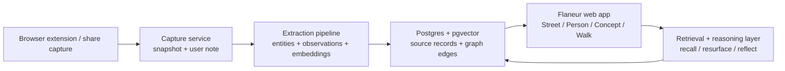

# Flaneur — Product Requirements Document

2026-10-10 · Updated product direction

> **Flaneur is a personal memory for the people and ideas you notice. It remembers what caught your attention, understands the relationships between those discoveries, and brings them back when they become useful.**

## 1. Product definition

Flaneur is a private, single-user memory system for a person's trail of attention across people, work, posts, ideas, and trajectories.

The product begins with a familiar behavior: you encounter someone or something interesting, save it, and move on. Months later you may remember only a fragment — a career transition, a technique, a sentence, a school, a project, or simply that *someone had solved something like this before*. Conventional bookmarks preserve the artifact but rarely preserve why it mattered. Search engines can tell you what exists on the internet, but not what **you have already discovered**.

Flaneur preserves that trail. It captures the source, the person behind it, the user's reason for noticing it, and the relationships that become visible over time. When the user's current work makes an old discovery relevant again, Flaneur should be able to reconstruct the path back to it.

The knowledge graph is the internal mechanism. **Memory, recall, resurfacing, and reflection are the product.**

## 2. Core insight

The internet is good at discovery and bad at continuity.

People continuously encounter useful profiles, posts, projects, portfolios, articles, and ideas. The moment of attention is rich in context: *why this person is interesting, what was unusual about their path, what technique stood out, what connection the user made*. That context decays quickly.

Flaneur's opportunity is not to become a better folder system. It is to preserve the context of attention and make it queryable later.

A useful shorthand:

**Notice → Save → Forget → Need → Resurface → Connect**

Over a longer period:

**Notice → Accumulate → Reflect → Understand your own patterns**

## 3. Problems being solved

### 3.1 Fragmented recall

The user often remembers meaning but not metadata.

Examples:

- "Who was that mechanical engineer who moved into AI?"
- "I saved someone from EPFL working in computational design."
- "There was a post about keeping 3D interactions performant on the web."

Traditional search expects names, titles, folders, exact keywords, or a remembered source. Human memory often has none of those.

### 3.2 Context loss

A bookmark answers *what was saved*. It usually does not answer *why it was saved*.

The user's reason for noticing something is often the most valuable future retrieval cue. Flaneur must preserve that reason explicitly when supplied by the user and infer a tentative version when it is not.

### 3.3 People are reduced to profiles

A professional profile contains facts. What the user needs later is a memory of the person:

- why they first stood out;
- what work or writing was encountered;
- how their trajectory changed;
- which ideas are associated with them;
- when and why they became relevant again.

Flaneur should remember **encounters with a person**, not merely mirror a profile.

### 3.4 Saved things do not reveal their collective shape

The value of a collection is not only retrieval of individual items. Repeated interests, similar trajectories, recurring disciplines, and unexpected overlaps become visible only across many saved encounters.

Flaneur should help answer questions such as:

- "What patterns do you see among the people I keep saving?"
- "Which disciplines repeatedly intersect in my collection?"
- "Who have I noticed at the intersection of hardware and education?"

### 3.5 Current work is disconnected from past discovery

When the user starts a new project, they often search the web again from zero even though relevant discoveries already exist in their own archive.

Flaneur should first ask: **what has this user already encountered that matters here?** External research can remain complementary rather than replacing personal memory.

### 3.6 Platform dependence

Useful context is scattered across LinkedIn, personal websites, articles, portfolios, saved posts, screenshots, browser tabs, and eventually other sources. The memory should belong to the user rather than to a feed or platform interface.

## 4. What Flaneur is — and is not

| Flaneur is | Flaneur is not |
| --- | --- |
| A memory of your trail of attention | A generic bookmark manager |
| A way to recall by meaning, not only metadata | A folder/tag maintenance system |
| A person-and-idea graph built mostly automatically | A manual ontology or PKM hobby |
| A record of why someone or something mattered | A LinkedIn mirror |
| A system for resurfacing and reflection | A read-it-later queue |
| A private view of people you noticed, including strangers | A CRM limited to people you know |
| A finite, contextual resurfacing experience | An infinite recommendation feed |
| A provenance-aware assistant over your own discoveries | A general web search engine |

The market already contains strong products for universal capture, read-it-later, AI note search, automatic knowledge graphs, and relationship management. Flaneur should not compete by becoming another "save anything and search it" product. Its wedge is narrower: **people, the things people create, the trajectories they take, and the user's evolving reasons for noticing them.**

## 5. Governing product principles

### 5.1 Attention before organization

The user should never have to design the schema before saving something. Capture first. Structure can be inferred afterward.

### 5.2 Preserve the "why"

Every capture should have a `reason_for_noticing` field. It may be:

- written by the user;
- inferred by Flaneur and clearly marked as an inference;
- refined later as more context appears.

### 5.3 Objects first, graph second

People, posts, projects, observations, and ideas should be legible on their own. The graph supports those objects; the user should not be required to maintain or navigate a node diagram to receive value.

### 5.4 Provenance over confident synthesis

Flaneur must distinguish:

- what the source explicitly says;
- what the user wrote;
- what the system extracted;
- what the system inferred.

Every generated answer should be traceable back to evidence.

### 5.5 Recall before recommendation

When the user asks about a topic, Flaneur should first surface relevant material from the user's own trail. It should not default to generic internet advice.

### 5.6 No guilt loops

No unbounded queues, unread counts, overdue badges, streaks, or "you have 83 items to review" mechanics. Resurfacing is an invitation, not maintenance debt.

### 5.7 Finite serendipity

A Walk is deliberately short. Discovery should feel chosen and complete, not optimized for session length.

### 5.8 Quiet intelligence

The system should do heavy extraction and linking in the background without constantly announcing AI. Intelligence is demonstrated through useful recall and connections, not through decorative AI features.

## 6. Jobs to be done

### Recall

**When I only remember fragments of something I encountered, help me find it without needing the original name or exact wording.**

Example: "Who was that mechanical engineer who later moved into machine learning?"

### Resurface

**When I am working on something now, bring back people, work, and ideas I encountered earlier that may be relevant.**

Example: "I'm building a 3D interaction website. What have I saved that could help?"

### Understand a person

**When I return to someone months later, remind me why they mattered to me, what I encountered from them, and how their path fits together.**

### Reflect

**When enough history exists, show me patterns in what repeatedly captures my attention.**

Example: "What do the founders I keep saving have in common?"

### Reconnect

**When an old person becomes relevant to my current work, help me recognize that moment without turning the product into a sales pipeline.**

## 7. Core product model

### 7.1 Person

A person encountered through a profile, post, article, portfolio, project, or other source.

Key fields:

- name and canonical identity;
- current role and organization;
- headline/about text;
- education;
- experience and career trajectory;
- disciplines/skills/topics;
- linked artifacts;
- linked encounters;
- user-authored observations;
- inferred observations;
- source URLs and timestamps;
- embeddings/search representation.

### 7.2 Artifact

Something created by or associated with a person.

Types initially include:

- social post;
- article;
- project;
- portfolio page;
- personal website;
- profile page.

Later types may include talks, videos, papers, repositories, images, and saved snippets.

Key fields: type, title/text, author, source, capture snapshot, published date if known, concepts, media, provenance, embedding.

### 7.3 Encounter

The unit that records **the user's contact with something**.

An encounter is not the same as an artifact. The same person may be encountered many times over years.

Key fields:

- encountered object(s);
- capture timestamp;
- source/context;
- user note;
- `reason_for_noticing`;
- inferred reason, if no user reason exists;
- current project/context if supplied;
- resurfacing history;
- action taken, if any.

This object is central to Flaneur. It preserves the history of attention rather than collapsing repeated encounters into a deduplicated bookmark.

### 7.4 Observation

A concise statement about a person, artifact, encounter, or pattern.

Observation types:

- **User observation** — explicitly written by the user.
- **Source fact** — directly supported by captured material.
- **System extraction** — structured information parsed from a source.
- **System inference** — interpretation that may be useful but is not stated by the source.

These types must remain distinguishable in the data model and interface.

### 7.5 Concept

An idea, discipline, technique, interest, tool, or theme linked to people, artifacts, and encounters.

Concepts should be merged conservatively. Source-authored terms such as hashtags or headings remain distinct from inferred concepts so provenance is not lost.

### 7.6 Organization and Place

Organizations, schools, labs, companies, and places provide high-value retrieval cues such as "people I saved from EPFL" or "people working in Copenhagen." They should be modeled as entities rather than buried strings when extraction confidence is sufficient.

### 7.7 Correspondence

A meaningful, evidence-backed relationship discovered between things encountered separately.

Examples:

- several people with a similar career transition;
- the same idea appearing across unrelated disciplines;
- a person saved long ago becoming relevant to a current project;
- two clusters repeatedly co-occurring through different sources.

A correspondence must store the evidence that produced it and should be written as an observation, not a claim of objective truth.

## 8. Primary experience architecture

The previous model treated the Walk as home. The updated product makes **The Street** the primary entry point because active recall and contextual resurfacing are the clearest immediate value. The Walk becomes the finite passive-resurfacing experience.

### 8.1 The Street — ask your trail

The Street is the default home/search surface.

Primary prompt:

**What are you trying to remember, find, or think through?**

It supports three query behaviors behind one interface:

1. **Recall** — locate a half-remembered person, post, project, or idea.
2. **Resurface** — use current intent to retrieve older relevant discoveries.
3. **Reflect** — synthesize patterns across saved people, artifacts, and encounters.

Example prompts:

- Who was that mechanical engineer who moved into AI?
- Have I saved anyone from EPFL working in computational design?
- What have I previously found about performant 3D websites?
- I'm exploring 3D interaction. What in my trail could help?
- Who have I saved at the intersection of hardware and education?
- What patterns do you see among the people I keep noticing?

Results should not be a chatbot wall of text. The response should lead with a concise answer and then show the underlying people, artifacts, encounters, and evidence that support it.

### 8.2 Capture

Capture must remain almost frictionless.

On a supported source, the extension presents:

- Save;
- an optional field: **What caught your attention?**

On save, Flaneur captures the visible source and immediately confirms. Extraction, entity resolution, concept linking, trajectory parsing, and inferred reason can continue in the background.

The user's note is never required.

If Flaneur proposes a reason such as "career transition from mechanical engineering into AI," it must be visually marked as inferred and easy to edit.

### 8.3 Person — memory of a person

A Person page answers **why is this person in my world?** rather than reproducing LinkedIn.

Recommended hierarchy:

1. Identity and present context.
2. Why you noticed them.
3. Encounters — chronological history of when/where they re-entered your attention.
4. Trajectory — education, roles, discipline changes, company changes.
5. Work and posts you saved.
6. Ideas/concepts associated with them.
7. Correspondences — similar trajectories, shared interests, links to other people.
8. Relevance now — only when current context provides a meaningful reason.
9. Provenance/source access.

### 8.4 Concept

A Concept page is not a folder of tagged items. It is a view of how an idea has appeared across the user's trail.

It can show:

- people associated with it;
- artifacts in which it appeared;
- the user's observations;
- adjacent concepts;
- changes over time;
- recurring cross-disciplinary contexts;
- relevant current work.

### 8.5 The Walk

The Walk is a finite resurfacing session, typically **three stops**.

Its purpose is not spaced-repetition homework. It is deliberate rediscovery.

A Walk may contain:

- something old that has become relevant;
- a person whose trajectory has changed;
- a forgotten artifact connected to a recent interest;
- a correspondence between two previously separate discoveries.

Each stop should explain *why it is appearing now* when there is a reason beyond age.

The session ends. There is no infinite feed and no count of what remains.

Suggested actions should be plain and low-stakes. The earlier metaphorical actions (`say hello`, `keep walking`, `street's closed`, `just passing`) may remain selectively, but they are no longer the scheduling backbone of the system.

### 8.6 Atlas

The Atlas shows **the shape of the user's attention**, not a database diagram.

Top-level views may organize the collection through:

- recurring concepts;
- groups of people;
- trajectories;
- disciplines;
- organizations/schools;
- places;
- unexpected clusters.

The visual should remain object-first and legible. A force-directed node graph is explicitly not the default.

Atlas should become useful only after enough data exists; it is not required for the first-run experience.

### 8.7 Correspondence

Correspondence is a core product capability, not merely an Atlas animation.

It can appear:

- inline within Street results;
- on Person and Concept pages;
- as a stop in a Walk;
- within Atlas;
- in periodic reflection surfaces.

Every correspondence must answer:

- what was connected;
- why Flaneur thinks the relationship is meaningful;
- which evidence supports it;
- whether the relationship is fact, extraction, or inference.

### 8.8 Reach out / relationship state

Relationship management is secondary.

If the user chooses to contact someone, Flaneur may record a lightweight state such as `not contacted`, `contacted`, `replied`, or `quiet`. This should not become a core navigation destination, sales pipeline, overdue system, or motivation mechanic.

## 9. Search and reasoning model

Vector similarity alone is insufficient for the product we now want.

Flaneur should combine several retrieval signals:

1. **Semantic retrieval** — embeddings over artifacts, observations, reasons for noticing, person summaries, and concepts.
2. **Structured filters** — education, organization, role, place, dates, source type, relationship state.
3. **Entity graph traversal** — person → artifact → concept → person relationships.
4. **Temporal relevance** — when something was encountered, resurfaced, or updated.
5. **Current context** — explicit project/problem supplied by the user.
6. **Personal salience** — user-authored notes and repeated encounters should rank above weak inferred associations.

The query planner should classify a request as primarily recall, resurface, or reflect, then retrieve evidence before synthesis.

### Answer generation

Generated answers follow an evidence-first pipeline:

**Query → retrieve evidence → rank → construct bounded context → synthesize → attach provenance**

The model must not invent missing career transitions, relationships, schools, or motivations. Uncertain matches should be expressed as uncertain.

## 10. Resurfacing model

The previous PRD used SM-2 spaced repetition as the primary engine. That model is too close to review homework for the clarified product.

The updated resurfacing score should be contextual rather than purely schedule-driven.

Candidate signals include:

- time since last encounter;
- strength of the user's original note;
- number of repeated encounters;
- semantic similarity to recent/current context;
- newly discovered correspondence;
- meaningful source/profile change;
- diversity relative to other Walk stops;
- whether the item has been repeatedly dismissed.

MMR or another diversity strategy remains useful for composing a short Walk, but **there is no requirement that every saved item eventually become due**.

This distinction is important: Flaneur is allowed to forget low-value things quietly.

## 11. Provenance and trust model

Every meaningful statement in Flaneur belongs to one of four truth layers:

| Layer | Meaning | Example |
| --- | --- | --- |
| User | Written or confirmed by the user | "I liked her transition from engineering to design." |
| Source | Explicitly stated in captured material | "MSc Mechanical Engineering, EPFL" |
| Extracted | Structured by Flaneur from source evidence | `education.school = EPFL` |
| Inferred | A system interpretation | "Cross-disciplinary career shift" |

The UI must make inference distinguishable without making the product visually noisy.

Users should always be able to inspect the source behind a fact or answer.

## 12. MVP scope

The MVP should be narrower than the previous PRD.

### Supported source focus

Start with **people and the things people create**, rather than universal web capture.

Priority sources:

1. LinkedIn profile.
2. LinkedIn post.
3. Personal website / portfolio.
4. Article or project page with a clear author/person relationship.

### MVP capabilities

- One-click browser capture.
- Optional "What caught your attention?" note.
- Person and Artifact entity creation.
- Encounter history.
- Automatic extraction of role, organization, education, topics, and basic trajectory.
- Inferred reason for noticing when useful, clearly marked.
- Semantic + structured search across the user's trail.
- Street with strong Recall and Resurface queries.
- Person page focused on why the person matters and the user's encounters.
- Evidence/provenance on generated answers.
- A simple three-stop Walk using age + salience + diversity.

### Explicitly deferred

- Fully visual Atlas.
- Broad universal bookmarking.
- Automatic relationship outreach.
- Social/shared collections.
- Complex CRM functionality.
- Annual retrospective.
- Deep automated correspondence synthesis at very low data volume.

## 13. Success criteria

Early success is not measured by time spent in the app.

The MVP succeeds if a user with a few months of captures can reliably do the following:

1. Find a half-remembered person from fragmentary clues.
2. Recover the original reason they saved that person or work.
3. Ask about a current project and receive relevant items from their own past discoveries.
4. Understand how a person, their work, and related ideas connect.
5. Encounter at least occasional resurfacing that feels timely rather than random.
6. Trust the answer because source facts and system inferences are visibly distinguishable.

Suggested quantitative product measures for testing:

- capture completion rate;
- median capture time;
- successful retrieval rate on user-generated recall tasks;
- percentage of Street answers that lead to an opened source/person/artifact;
- rate at which users mark resurfaced items as useful/relevant;
- false-connection / incorrect-inference reports;
- percentage of users who can answer "why did I save this?" from the Person/Artifact page.

Avoid optimizing for daily streaks, feed depth, or review completion.

## 14. Technical architecture

A practical initial stack can remain lightweight:

Recommended persistence model:

- `person`
- `artifact`
- `encounter`
- `observation`
- `concept`
- `organization`
- `place`
- typed relationship/edge table
- capture/source snapshot table
- optional `current_context` / project table later

Postgres + pgvector remains appropriate for an early single-user or small-scale product, but the schema should not encode LinkedIn-specific assumptions into core domain objects.

### Capture architecture risk

LinkedIn has no general public API that supports this product's intended capture behavior. DOM-based browser capture is inherently fragile and may conflict with platform terms depending on implementation. The parser must therefore be isolated as a replaceable adapter, and the product should store the user's captured snapshot rather than depend on future live re-fetches.

Avoid aggressive background scraping. Profile refresh should be user-initiated or tightly constrained until legal/platform risk is resolved.

## 15. Roadmap

| Phase | Product goal | Scope |
| --- | --- | --- |
| **Prototype** | Prove semantic personal recall | Manual/imported seed data, capture prototype, Person/Artifact/Encounter model, Street queries |
| **v1** | Make the saved trail genuinely retrievable | Browser capture, extraction, provenance, Recall + Resurface, Person page, simple three-stop Walk |
| **v1.5** | Make relationships between discoveries useful | Concept pages, stronger graph traversal, basic correspondences, current-context prompts |
| **v2** | Reveal the shape of attention | Atlas, trajectory clustering, recurring-pattern reflection, richer correspondences |
| **v3** | Build long-term reflective memory | Time-based evolution, annual retrospective, project context integrations, optional broader capture sources |

A graph visualization is not a milestone by itself. Each graph feature ships only when it improves a concrete recall, resurfacing, or reflection job.

## 16. Open questions and risks

### Product risks

- **Too close to existing save/search tools.** If Flaneur becomes generic capture + semantic search, products such as mymind, Recall, Fabric, Readwise, Sublime, and others already cover much of the value. The person/encounter/trajectory model must remain central.
- **Cold start.** Reflection and correspondence are weak at low volume. Recall must be useful with a small collection.
- **Inference that feels creepy or wrong.** Pattern recognition must be evidence-backed, restrained, and dismissible.
- **Over-automation.** Automatically assigning meaning can erase the user's own interpretation. User-authored observations always outrank inferred ones.
- **Becoming a CRM.** Outreach/status features are useful only when subordinate to memory.
- **Becoming PKM work.** If the user must constantly tag, clean entities, or maintain graph structure, the product has failed its core premise.

### Data and platform risks

- LinkedIn DOM changes and platform restrictions.
- Duplicate person/entity resolution across sources.
- Stale career information.
- Broken or deleted source URLs.
- Private/sensitive personal information captured from profiles.
- Model hallucination during extraction or synthesis.
- User trust if source and inference are visually conflated.

## 17. Non-goals for the near term

- Team knowledge management.
- Public social graph discovery.
- Recruiting CRM.
- Sales automation.
- Contact enrichment at scale.
- Generic web clipping for every media type.
- An inbox that demands review.
- A productivity dashboard.
- A "second brain" that asks the user to continuously organize it.

## 18. Governing sentence

> **You are not managing a network or maintaining a second brain. You are keeping a memory of what caught your attention — so your past discoveries can become useful again.**
