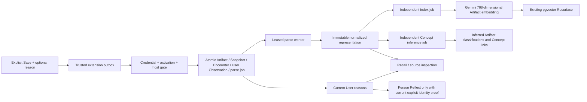

# Milestone D — controlled Capture V2 for new saves

Status, 2026-10-20: **READY for the controlled local workflow.** The real
profile, post, web, duplicate and durable queued-work restart checks passed;
all 436 tests and both TypeScript checks pass. Read the
[final acceptance report](MILESTONE_D_ACCEPTANCE.md) for actual IDs, provider
results, retrieval ranks, every added notebook row and operational limits.
Milestone C remains approved. No deployment, unrestricted hosted activation
or historical backfill is authorized. Earlier pending statements below
describe the preparation checkpoints before real-source acceptance.

## Audit and implementation plan

The starting Git revision was `0299ff0` (approved Milestone C); the working tree was clean. Existing V2 capture already atomically stored a source Artifact, compressed Snapshot, independent Encounter, optional exact User reason, request receipt and durable parse job. It used authenticated extension delivery, a trusted-context outbox, alarms, bounded retries, leases and fenced completion. Parsing and identity review already existed. The runnable worker handled parsing only; legacy enrichment bypassed that queue and could update historical roles/Person synthesis. The extension and normalizer only supported LinkedIn. Reflect read legacy notes but omitted new Encounter User reasons.

Before coding, the implementation plan was reported: preserve those foundations, scope activation and job claims to new controlled captures, add deliberate ordinary-page capture, connect parsing to independent durable embedding/Concept jobs, add truthful progress and V2 note reading, validate locally, then perform selected real captures. No new identity system, distributed worker platform, schema migration or broad redesign was introduced.

Read-only Neon dev preflight confirmed 41 public tables, pgvector 0.8.6, 18 matching migration ledger entries and no pending migrations. Local `CAPTURE_V2_ENABLED` was false. The configured `DATABASE_URL` and `DIRECT_URL` endpoint identities differed; no endpoint or credentials were printed. The controlled launcher therefore overrides its child application's runtime database with `DIRECT_URL`, and its worker explicitly uses `DIRECT_URL`. Ordinary application/deployment environment settings remain unchanged.

Chrome's `Default` profile registers the current unpacked extension at `D:\_my files\Flaneur\flaneur-v2\extension\dist`, ID `emfjbamhamkkanpmhhbbenhkpmfckjlk`. A second older Flaneur extension is registered from `D:\_my files\My_Projects\Flaneur\flaneur-extension\build\chrome-mv3-dev`, ID `ikacokjegeneikdmimglbglmepmpbpeh`. Registration is not proof of its currently running code/version. No personal browser settings, existing extension registration or storage were modified during inspection.

## Architecture actually implemented



This architecture has been exercised with real PostgreSQL transactions and an actual installed browser extension using **synthetic sources and providers**. It has not yet been exercised with the user's real new saves.

## Activation and local runtime

### Controlled real-source setup — 2026-10-19

Real post/recovery update, 2026-10-20: request
5603b948-9033-43a0-9658-807aa0639e62 preserved the exact reason
`procedural materials`. The actual queued parse job survived the runtime
restart unchanged and then all three stages succeeded once. All 24
earlier jobs retained their original one successful run. The Artifact has
a live 768-dimensional Gemini embedding and three inferred Artifact
Concepts; no authorship or Person facts were invented. Exact Recall is
rank 1; the approved 3D question returns the post at rank 5 using the real
planner and unchanged ranking. No historical baseline public row changed.
HTTPS and the bounded worker are running normally again.
[Exact post and recovery report](POST_CAPTURE_ACCEPTANCE.md).
Only the real generic-web source remains in the selected three-source
sequence; Milestone D remains PARTIALLY READY.

Deliberate duplicate update, 2026-10-20: request
5c30e58e-f96d-46a8-aa18-75ce6ae81640 passed the same-URL/different-reason
case. Artifact unchanged; Snapshot, Encounter and exact User reason
`duplicate test` are new. Earlier seven records and reasons are intact.
All 24 jobs have succeeded once, and Recall returns one Artifact with both
reasons. [Before/after report](DUPLICATE_CAPTURE_ACCEPTANCE.md).
Only the bounded worker is now intentionally stopped; HTTPS intake remains
up (health 200) to accept the one selected post before testing durable
pending-job restart/recovery. Do not restart or recapture prematurely.

Real profile update, 2026-10-20: all seven queued profile Save requests have
arrived. They created one Artifact, seven Snapshots, seven Encounters and
seven exact User reasons. All 21 parse/index/enrichment jobs succeeded once;
there is no parser quarantine, Person creation or automatic reviewed fact.
Read-only baseline comparison finds no changed historical public rows.
Exact Recall and a relevant live industrial-design/AI-filmmaking Resurface
query each return the one Artifact at rank 1. Person identity remains
unresolved. All IDs, provenance, provider outcomes, retained historical
Concept links and write deltas are recorded in
[real profile acceptance](PROFILE_CAPTURE_ACCEPTANCE.md). Deliberate
distinct-note duplicate, post, web and pending-job recovery acceptance
remain outstanding; Milestone D is still PARTIALLY READY.

Certificate follow-up, 2026-10-20: owner browser login now succeeds.
Seven extension requests remain queued with NETWORK_ERROR; the manifest's
localhost permission is granted. The extension Network panel identifies
certificate errors for both capture and credential-free health requests.
No capture receipts exist in Neon dev. A constrained local authority and
separate localhost server certificate are prepared, with 11 focused tests
passing. No trust has been installed and no further saves are requested.
The exact account-level trust proposal and removal command require owner
approval: [Local TLS correction](LOCAL_CAPTURE_TLS.md).

Subsequent explicit approval: the reviewed, localhost-constrained authority
is now installed in the current Windows account's Root store. Restart kept
the same activation window and host restrictions. Windows certificate
validation returns health 200 without a TLS bypass. The worker remains
running with zero captures and no new receipts exist. Chrome extension
reload and successful delivery remain unverified manual steps; this does
not yet establish real-source acceptance.

Follow-up, 2026-10-20: the owner reset their forgotten password locally.
The owner ID and capture credential were retained; only the local password
hash was cleared and re-enrolled. Browser login then returned 503 because
the launcher used Node's dotenv parser, which retained auth:setup's dollar
escape characters. The launcher now loads settings with the installed
Next environment loader before supplying its protected child environment.
Ten focused tests pass, including the full escaped-file → launcher → child
Next round trip. After restarting with the same activation timestamp, an
invalid-action HTTPS session probe returned the expected 400 instead of
503, proving runtime configuration construction succeeds without submitting
a password, consuming a login attempt or writing session records. The
bounded worker still reports zero captures. Successful browser login and
all-devices sign-out remain manual pending steps. The original baseline
environment-file checksum predates this intentional password reset; do not
misclassify that credential change as a capture-related environment edit.

The owner selected these acceptance sources: LinkedIn profile
https://www.linkedin.com/in/dhilipkumarsomesh/, LinkedIn activity
7517049371402870784, and https://www.gianlucaboccia.me/.
Started locally with:

```powershell
npm run capture:dev -- --run --hosts=www.linkedin.com,www.gianlucaboccia.me
```

The persisted activation begins at 2026-10-19T16:55:41.321Z. HTTPS checks
verified the generated local certificate and returned health 200, login 200,
and capture GET 405. The bounded worker reported zero eligible Snapshots
and no historical queue processing. A read-only pre-capture baseline of all
41 public tables (object IDs and row checksums only) is saved in ignored
`node_modules/.cache/flaneur/controlled-dev/before-real-captures.json`.
The development extension is version 0.3.0 and its only backend host
permission is `https://localhost:3443/*`.

The launcher now protects dollar-containing capture credentials through
Next's dotenv expansion, alongside its existing database/password handling.
A regression against the installed Next environment loader and the eight
controlled-capture tests pass (9 targeted tests).

**Stopped for manual browser setup.** No browser certificate acceptance,
extension installation/configuration, owner login or real capture has been
assumed. The owner must confirm setup before the first profile Save.
The profile reason is exactly “Interesting person and career path worth
remembering.” Inspect that request before any later source, and perform the
intentional duplicate only after the first graph is correct. The post and
web reasons must come from the owner. No deployment, historical backfill,
permanent environment-file edit or database write occurred during setup.
Milestone D remains **PARTIALLY READY** pending the real acceptance sequence.

Controls are `CAPTURE_V2_ENABLED=true`, a valid ISO `CAPTURE_V2_ACTIVATED_AT`, and comma-separated exact `CAPTURE_V2_ALLOWED_HOSTS`. Missing/invalid controls fail closed. Authentication precedes body reading; an unapproved source host is rejected before database writes. While the V2 flag is true, the authenticated legacy capture endpoint returns 410 before its old synchronous writer/enricher can run.

The controlled worker selects only `capture_request` Snapshots received since activation and on allowed source hosts. Both normal claims and expired/exhausted lease handling are restricted to that explicit Snapshot set. The generic historical queue is not drained. A 1,000-capture window limit bounds this initial private runtime. No historical V1 record is scanned for enrichment or migrated into this path.

The prepared local launcher uses the built Next application behind loopback HTTPS, binds to Neon dev through `DIRECT_URL`, and starts the bounded polling worker. It does not edit `.env`, change Vercel settings, provision a service or install a trusted root certificate. A local self-signed certificate is generated under ignored `node_modules/.cache/flaneur/controlled-dev`; it expires after seven days and is regenerated on a later start when expired. Browser certificate acceptance is a local setup step. The activation timestamp and database-target fingerprint persist in `activation.json` there, so restarts retain eligibility for pending captures rather than starting a new window and stranding work. A changed database target fails closed. The normal production extension output is separate from `extension/dev-dist`.

### Exact local-use steps, after choosing the real test sources

1. Supply one LinkedIn profile URL, one LinkedIn post URL about 3D/mobile performance, and one normal project/article URL. These were requested during implementation and remain pending. Keep credentials out of chat.
2. Run `npm run build`. Do not deploy it.
3. Start `npm run capture:dev -- --run --hosts=www.linkedin.com,ACTUAL_PROJECT_HOST`, substituting only the selected project's exact hostname. This explicitly enables the owner-only **local** process; the saved `.env` flag stays off. The launcher stays running until stopped. Standalone `npm run capture:dev -- --check` starts nothing and reads no database configuration.
4. Open `https://localhost:3443`, inspect/accept the local certificate, and use the existing owner-password login for source inspection. The local process supplies the matching session origin without changing the hosted origin.
5. In Chrome/Edge extension management, disable the older Flaneur extension and the production-directed current copy for this test. Enable developer mode and **Load unpacked** from `D:\_my files\Flaneur\flaneur-v2\extension\dev-dist`. Open its options and configure the private capture credential locally. It is never bundled or supplied through chat. Changes to extension permissions/version require reload/acceptance; the current version is 0.3.0.
6. Capture the selected profile using its existing Save button. Capture the selected post with its existing “Save this post to Flaneur” context menu. For the selected web page, click the Flaneur toolbar action, optionally enter what caught your attention, and Save. Generic pages use temporary `activeTab` access and script injection on an explicit gesture, rather than automatic access to all visited sites. See [Chrome's activeTab/script-injection documentation](https://developer.chrome.com/docs/extensions/get-started/tutorial/scripts-activetab).
7. Inspect **each** new capture before proceeding. `node scripts/capture/inspect.mjs --latest` reads the latest capture since this local activation; alternatively, `node scripts/capture/inspect.mjs --request-id=REQUEST_UUID` reads exactly that capture graph through `DIRECT_URL` and prints its object ids, owner observations, representation hashes, embeddings, Concepts, relationships and job/run history. It does not print raw source HTML, connection strings or provider credentials. The report includes its request UUID for repeat inspection; the latest lookup never falls back to historical records.
8. Verify exact-item Recall, then the approved performant-3D Resurface question. Repeat the same source URL intentionally and compare the graphs. Do not treat the synthetic results below as evidence that these real workflows have passed.
9. Stop the local launcher to stop intake/processing. Do not enable the hosted deployment, re-enable an older capture path as a fallback, reset the activation state while work is pending, or run `worker:parse -- --run` against the general queue for this milestone.

The current launcher/real-source workflow has **not** been started in this implementation session. Source URLs, signed-in LinkedIn interaction, local certificate acceptance and real owner login remain necessary to complete that acceptance step. Its setup/child-process lifecycle still needs that real smoke test; only its non-starting check was executed.

## Object and trust behavior

**Artifacts.** LinkedIn profile document identity remains exact URL identity, not Person identity. Posts reuse the existing supported URN rules. Ordinary web documents use an adapter-specific hash of their exact supplied HTTPS URL. Query/path variants are deliberately not guessed to be equivalent. Archived/aliased/conflicting registered sources remain unresolved rather than being revived. Legacy V1 Artifacts are not adopted through old Person/URL projections. Web documents use existing `article` Artifact storage and the existing Snapshot `post` capture bucket with `adapter_id='web'`; this is compatibility storage, not a claim of social-post genre. Source inspection labels them “Web page” and omits unsupported LinkedIn identity/authorship forms.

**Encounters.** Every intentional Save has a new request UUID, Snapshot and Encounter, including deliberate duplicate URLs. Retries of one immutable request replay the same receipt and Encounter. Client capture time remains explicitly unverified; server receipt time orders projections/processing. Saving an Artifact and noticing it are separate records.

**People.** Capture does not create or merge People by name or from a URL. A profile remains source-first and unresolved until the existing explicit identity review resolves/creates a Person safely. Existing Person creation, confirmation, reassignment and rejection services remain authoritative; successful parsing alone is not a reviewed identity. Ordinary web capture never invents a Person. LinkedIn post authorship remains subject to the existing evidence/review rules.

**Owner notes.** Exact optional reasons remain User Observations on the Encounter. Source links make those reasons available to Artifact Recall, Resurface and contextual Walk. New Person Reflect attention uses current V2 User observations on that Person or on an Encounter with a current explicit identity proof and `noticed` link. A generic Artifact author projection cannot attribute those notes to a Person. Generic notes still cannot corroborate a narrow role pattern. User reasons remain distinct from source text and are not used as source-backed Concept facts.

**Provenance.** Original gzip bytes, content hashes, exact source URL metadata, immutable normalized representations and code-point source evidence are retained. Concept inference records its input Snapshot, representation, parse fingerprint, semantic fingerprint, prompt/model and support reference, with `truth_layer='inferred'`, classification role and partial support. It never creates a reviewed relationship. Current-head checks retire obsolete inferred support from ordinary retrieval; managed Concept bridges also require current supported inference. No inferred Concept is propagated from an Artifact to its Person/author.

**Embeddings/enrichment.** Indexing uses `gemini-embedding-001@768`, `RETRIEVAL_DOCUMENT`, for source Artifact text plus separately labelled owner-reason context. New Concept embeddings use `SEMANTIC_SIMILARITY`. Concepts are inferred by the existing pinned Groq `openai/gpt-oss-120b` client, capped at three, validated and linked as inferred Artifact concepts. Exact active Concept labels may be reused; ambiguous identities are not merged. Historical Concept vectors, role classifications, Person synthesis, counts and topic promotion are not re-enriched by this runtime. It does not generate Person-profile vectors from unresolved sources. Source Artifact vectors provide Milestone B participation without inventing a Person.

**Jobs/recovery.** Parsing commits before separate index/enrich jobs are scheduled by the bounded sweep. Scheduling is idempotent and also recovers a process interruption between parse completion and scheduling on the next sweep. Provider work runs outside transactions. Independent job kinds prevent a Concept-provider failure from losing a saved source or blocking an independent embedding job. Five attempts, backoff, renewable leases, current-input checks and atomic completion remain in place. A heartbeat renews semantic jobs during long provider calls. An expired lease can be reclaimed after restart and old tokens cannot publish. The launcher uses a local five-second polling loop, not a hosted scheduler. The claim budget stops new claims; it does not forcibly interrupt an in-flight provider request.

**Duplicates.** Two saves of one exact supported URL reuse one Artifact while preserving two Snapshots, two Encounters and their independent reasons. Only the newest server-received capture schedules semantic work for that Artifact. Repeated sweeps/replays do not repeatedly call providers after a current job succeeds. New intentional versions can create a bounded new pair of index/enrich jobs; they are not collapsed into lost encounters. Older source inspection states that a newer capture represents the source rather than displaying perpetual processing for a superseded version.

**Progress.** The extension confirms local queueing versus durable remote saving. A parse-success receipt no longer claims all later processing has finished. Source inspection quietly shows Saved/Processing, Ready, processing-needs-attention, or that a newer capture represents the source. Technical job/run history is available through deliberate inspection, not a metadata form during Save.

## Validation and actual capture results

| Acceptance workflow | Synthetic/rollback/browser evidence | Actual real-source result |
|---|---|---|
| LinkedIn Person | Durable profile source + reason + normalization; zero guessed Person links or reviewed relationships | **Not run; profile URL and signed-in interaction pending** |
| LinkedIn post | Independent Artifact/Encounter/User reason; source-backed Recall; no auto-authorship | **Not run; post URL pending** |
| Normal web project | Actual extension toolbar action, page serialization, form exclusion and delivery; actual SQL normalization/vector storage with fake providers | **Not run; project URL pending** |
| Duplicate Save | One Artifact, two Snapshots/Encounters, immutable replay and separate reasons; bounded/idempotent processing | **Not run on a real chosen source** |
| Provider failure | Injected embedding outage preserves all saved originals, records safe retry state, then recovers; expired lease fencing | Simulation passes; **no real new capture/provider outage test claimed** |
| Retrieval after capture | Real SQL source Recall and pgvector operation; injected semantic score reaches existing Resurface ranking | **No real new capture or live post-capture Gemini/3D result yet** |
| Reflect safety | V2 reason requires current identity; Artifact Concept inference does not become Person reviewed support; A/B/C regressions | New-real-data participation **not yet demonstrated** |

Verified checks:

- Full application test suite: **433/433 tests pass**, including the controlled-capture and toolbar sender regressions and existing Milestone A/B/C tests.
- Application and extension TypeScript pass.
- Final production build and packaged 0.3.0 extension pass, including the new source-progress UI and truthful receipt wording.
- Installed-extension browser fixture: **41 passing assertions** in isolated Edge, real extension runtime/storage/alarms/forced worker stop/restart, synthetic pages/server/credential. Includes the actual toolbar action and generic web save. DevTools pipe transport is used for the extension action. A debug-installed fixture must be reloaded after browser restart; this is not proof of normal store-installed update behavior.
- Built-app HTTP: **18 disabled-capture + 22 controlled-activation + 106 existing source-identity/auth checks** pass. Configuration and credentials are synthetic and the database deliberately unreachable. These prove guards and legacy-path blocking, not a real enabled save.
- Rollback-only Neon dev SQL through `DIRECT_URL`: **39 controlled-capture checks**, **37 existing capture-runtime checks**, **60 source-resolution checks**, **15 memory-query checks** pass, **151 total**. Actual storage, parsing, job SQL, retry/recovery, vectors, provenance, graph inspection and progress queries are exercised. Providers and sources are synthetic; all writes roll back and checked aggregate counts stay unchanged. The controlled fixture scopes claims so unrelated queued work remains untouched.
- No live enrichment provider was invoked by these SQL/browser fixtures. No historical backfill, mass embedding, restore test, deployment or real queued-job processing occurred.

## Files changed

- Capture guards/contracts/resolution: `app/api/capture/{route.ts,v2/route.ts}`, `lib/capture/{activation,v2-contract,v2-handler,source-plan,postgres-source}.ts`.
- Durable runtime and provider stages: `lib/processing/{parse-input,extraction,postgres-extraction,apply-extraction,postgres-jobs,capture-semantic}.ts`, `scripts/processing/{capture.mjs,capture-runtime.ts}`. Completion lock order now matches graph-before-scope review/capture writers.
- Evidence and new-note reading: `lib/retrieval/{normalize,captured-source,reader,postgres-reader,postgres-semantic,pattern-owner-notes}.ts`.
- Extension: `extension/{manifest.json,background.ts,build.mjs}`, `extension/lib/{capture-v2,messages}.ts`, `extension/content/{web,deliver}.ts`.
- Quiet source progress: `app/snapshot/[id]/page.tsx`, `components/inspection/CaptureProgress.tsx`, `lib/capture/{readiness,readiness-postgres}.ts`.
- Local startup and graph inspection: `scripts/capture/{dev.mjs,inspect.mjs,inspect.ts}`, `package.json`, `.gitignore`.
- Validation: `scripts/phase2/{controlled-capture,extension-background}.test.mjs`, `scripts/database/{validate.mjs,validate.ts,validate-controlled-capture.ts}`, `scripts/browser/{validate-installed-extension,validate-capture-http}.mjs`.
- Handoff/status: this document and current entries in the migration, data-model and phase-status documents.

## Remaining limits and recommendation

1. Real controlled saves, actual post-capture Groq/Gemini output, per-capture object graphs and real post-capture Recall/3D Resurface remain **unverified**, not inferred from fixtures. No successful real capture result is fabricated here.
2. Chrome registration was inspected read-only; the real installed-extension fixture ran in isolated Edge. The owner's actual signed-in browser, local TLS acceptance, private login and new development extension installation remain to be exercised. LinkedIn DOM changes may still cause quarantine on real sources; originals remain saved.
3. Worker watch mode must remain running locally. Stopping it preserves the durable queue but delays processing until restarted; the lease may take up to five minutes to expire after a hard crash. Exhausted jobs remain visible as needing attention and require a separately scoped operator recovery; restarting does not reset their attempt history. No hosted/always-on runtime is promised.
4. Legacy `artifact.person_id` note-attribution debt is unchanged. New writes/readers in this slice do not require that shortcut: new reasons use V2 Observations and supported Encounter identity links. No historical attribution repair was attempted.
5. Permanent database writes performed in this session: **none**. SQL fixtures made temporary writes inside transactions that rolled back. There were **zero real controlled captures**, zero schema/migration changes, zero automatic reviewed facts and no historical data transformation. `.env` and hosted configuration are unchanged; saved Capture V2 activation remains off.
6. Do not run historical backfill next. Complete the selected real-source acceptance set, inspect every resulting graph, verify real retrieval and exercise local runtime restart/recovery first. Only then decide whether ordinary private use is ready. Milestone D remains **PARTIALLY READY** until that evidence exists.
